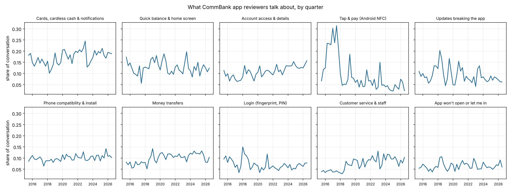
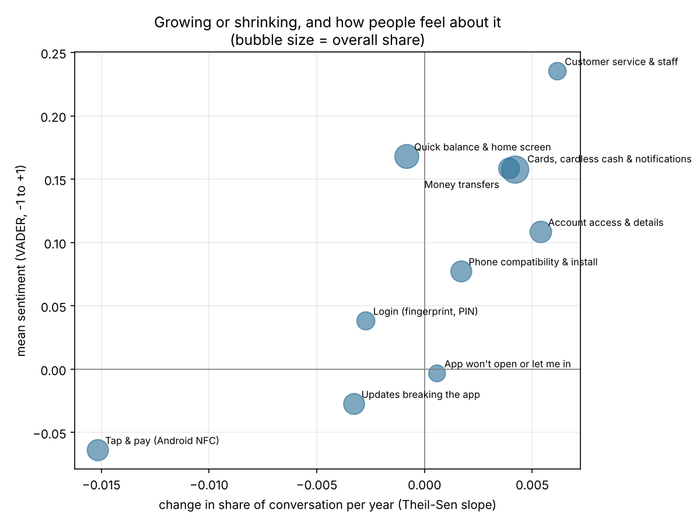
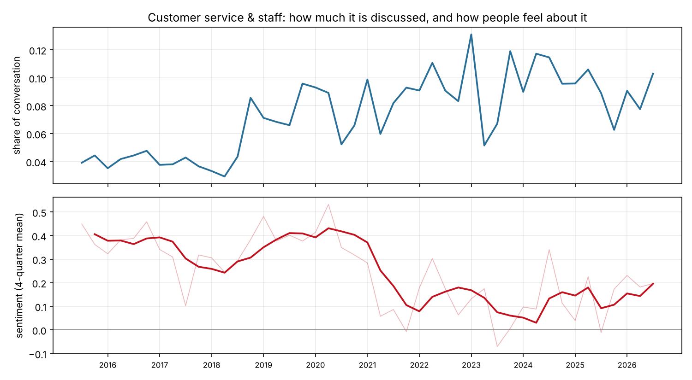
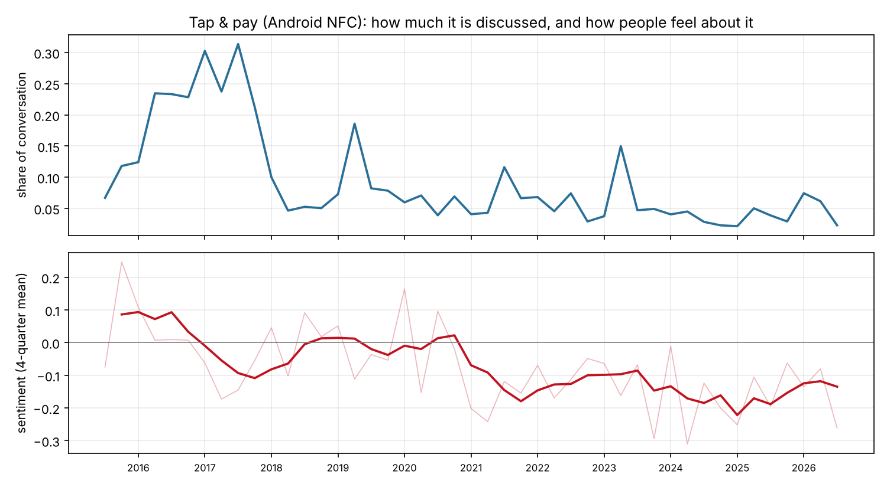

# Tracking Commonwealth Bank's quality determinants from digital Voice-of-Customer

What customers complain about changes. This project measures that change.

It implements the quality tracking framework from Barravecchia, Mastrogiacomo &
Franceschini (2023) on 20,000 Google Play reviews of the CommBank app
(2015 to 2026), then extends it with the sentiment layer the authors name as
missing.

**Two findings in one line each:**

- Customer service went from about 4% of what reviewers talk about to about 9%,
  and the mood when they talk about it fell from clearly positive to barely
  positive.
- Tap & pay was a quarter of the conversation in 2016 and 2017, then collapsed
  to about 6% right as CBA started supporting Android Pay. The people still
  talking about it are mostly complaining.



---

## The question

Traditional quality tracking asks customers to rate a list of attributes the
company wrote. You learn how you score on what you already thought to ask.
Digital Voice-of-Customer inverts that: customers write about whatever they
want, so the attribute list is discovered rather than imposed, and it can
change over time. A topic that did not exist last year can be the loudest thing
in the data this year.

The method here answers: **which quality determinants are gaining share of the
conversation, which are losing it, how fast, and when did something break?**

## Method

| Stage | What happens |
|---|---|
| Collect | Google Play (used here); Apple App Store and ProductReview.com.au collectors are included but not yet run |
| Model | One NMF topic model over the full corpus, so period-to-period numbers stay comparable |
| Track | Topic share per quarter (IMTP), trend direction and magnitude, anomaly detection |
| Extend | Sentiment per topic per period, so a rising topic is separable into praise and complaint |
| Interpret | Anomalies matched against dated public CBA events |

The core insight of the source paper, and the reason this is not just a topic
model: averaging topic shares over the whole window hides everything. The paper
demonstrates three determinants with near-identical whole-window averages
(0.36, 0.33, 0.31) whose month-by-month profiles move in completely different
directions. Same data, opposite conclusions, depending only on how you bucket it.

### Indicators

- **MTP** — mean topic proportion across the window. One number per topic.
- **IMTP** — the same mean taken *within* each sampling period. This is the
  series everything else is computed from.
- **Spearman's rho** on the IMTP series — direction only (rising, flat, falling),
  ignoring magnitude.
- **IMTP average slope** — magnitude, in share per period. Two topics can both
  be "rising" while one moves 2.4x faster.
- **Anomaly detection** — one-off spikes, temporary shifts, permanent level changes.

### Three things that will mislead you

**Shares are zero-sum.** Every period's topic shares sum to 1. So when a new
topic appears, every existing topic's share falls, arithmetically, whether or
not anything about them changed. The source paper's restaurant case shows this
directly: a "Covid rules" topic emerged and every continuing determinant
dropped. Nobody had gone off the food. Always check for new topics before
interpreting a decline.

**Topic numbers are not comparable across model runs.** Run the model again on
a different slice and you get different topics in a different order. Topic 4 in
one run has nothing to do with topic 4 in another. This is why the pipeline
fits **one** model over the full corpus rather than one per month, and it is
what constrains the choice of time window.

**Attention is not satisfaction.** Share of conversation says a topic is being
discussed, not whether people are happy. Hence the sentiment layer.

## Validation

The tracking indicators are unit-tested against every worked example printed in
the source paper: the topical prevalence matrix and MTP (Table 4), IMTP
(Table 5), Spearman's rho (Table 6, reproducing -0.964), and the IMTP average
slope (Table 7, reproducing 0.0461).

```bash
pytest -v
```

Two notes from doing this:

**A sign error in the published paper.** Section 4.3 prints the rule as
`if rS < +0.4 then decreasing`, which should read `-0.4`, and Table 8 then
labels increasing determinants `rS < -0.4`, with the signs swapped relative to
the text. Table 6's worked example settles which is intended: a declining
profile yields rho = -0.964. This repo uses the conventional sign, rho > 0
meaning the topic is gaining share, and has a test pinning it.

**The anomaly detector is mine, not the paper's.** Section 4.5 names the three
anomaly shapes but leaves the detector open, gesturing at control charts. The
implementation here forecasts each period from a robust fit to its trailing
window and flags periods the recent past failed to predict. It took three
designs to get right, and the two that failed are documented in the docstring
because both failures are instructive: residuals from a single global line
absorb a step change and report a permanent shift as two unrelated blips, and a
trailing median lags a trend badly enough to manufacture two sigma of deviation
before any noise, turning every rising topic into a wall of false alarms.

## Data

**What this run uses:** Google Play only. 20,000 reviews were collected; after
dropping reviews under five words, reviews with no topic words left, and the
two partial quarters at either end, 11,952 reviews across 45 quarters
(2015 Q3 to 2026 Q3) went into the model, between 138 and 604 per quarter.

The raw reviews are not committed, because scraped review text is not
redistributable. `collect_playstore.py` regenerates them. Everything derived
from them (topic terms, quarterly shares, sentiment, anomalies) is in
`outputs/`.

The table below describes all three sources the collectors support.

| Source | Volume | Dates | What it covers |
|---|---|---|---|
| Google Play | large, multi-year | exact timestamps | the CommBank app |
| Apple App Store | few thousand, recent | exact timestamps | the CommBank app |
| ProductReview.com.au | ~4,200 | **relative only** | the bank: branches, fees, disputes, call centres |

The two app stores carry exact timestamps and are what the time series
is built from. ProductReview publishes relative timestamps only ("3w", "2mo",
"4y"), so its dates are reconstructed with a recorded precision and error bar
per review, and it is used at quarterly resolution for the service-level topic
vocabulary rather than in the time series.

Worth knowing before pooling: the app stores score far higher than
ProductReview's 1.6 out of 5. These are different populations complaining about
different things, and the gap is a finding in its own right rather than
something to average away.

## Running it

```bash
pip install -r requirements.txt
pytest -q                                        # 56 tests, no data needed
python src/collect_playstore.py --max 20000      # the one that matters
python src/run_analysis.py                       # topics, tracking, sentiment, charts
```

No scipy. The analysis needs only Spearman's rho and a Theil-Sen fit from it,
both implemented in `src/_stats.py` and checked against scipy's versions to
1e-12 where scipy happens to be installed. A 30MB compiled wheel whose version
has to agree with numpy's is not worth twenty lines of code, particularly on
older Pythons where pip spends minutes backtracking over numpy/scipy/pandas
combinations before giving up.

Collection has to run somewhere with outbound access to the review sites.

The Apple App Store and ProductReview collectors are optional and have their
own dependency file, because `app-store-scraper` hard-pins `requests==2.23.0`
and cannot share an environment with a modern `requests` (pip backtracks
indefinitely rather than failing cleanly). Install them separately:

```bash
python3 -m venv .venv-collect && source .venv-collect/bin/activate
pip install -r requirements-appstore.txt
python src/collect_appstore.py
python src/collect_productreview.py --inspect    # check selectors first
deactivate
```

## Findings

### Topics

Ten topics, labelled by hand from their top terms (full lists in
`outputs/topic_terms.csv`). Words like "great", "easy" and "useless" were
removed before modelling, because left in they swallow half the topics and
describe reactions, not quality determinants. Sentiment is measured
separately.

| Topic | Share of conversation (MTP) | Trend (Spearman rho) | Mean sentiment | Mean star rating |
|---|---|---|---|---|
| Cards, cardless cash & notifications | 16.6% | rising (0.46) | +0.16 | 2.9 |
| Quick balance & home screen | 12.9% | flat (-0.13) | +0.17 | 2.9 |
| Account access & details | 10.4% | rising (0.71) | +0.11 | 2.6 |
| Tap & pay (Android NFC) | 10.1% | **falling (-0.70)** | **-0.06** | 2.4 |
| Updates breaking the app | 9.8% | flat (-0.34) | -0.03 | 2.0 |
| Phone compatibility & install | 9.8% | flat (0.39) | +0.08 | 2.6 |
| Money transfers | 9.7% | rising (0.57) | +0.16 | 2.9 |
| Login (fingerprint, PIN) | 7.4% | flat (-0.33) | +0.04 | 2.3 |
| Customer service & staff | 6.9% | **rising (0.72)** | +0.24 | 3.2 |
| App won't open or let me in | 6.4% | flat (0.13) | 0.00 | 2.1 |

Two topics have near-identical overall shares (Tap & pay 10.1%, Updates 9.8%)
and completely different histories, which is the paper's point about
whole-window averages in this dataset's own terms.



### 1. Customer service is a growing share of the conversation, and a less happy one

Customer service averaged **4.1%** of the conversation in 2015 to 2017 and
**9.4%** from 2023 on. It is the fastest-rising topic (rho 0.72).

On its own that would not be bad news: people mention staff when staff help
them. The sentiment layer is what changes the reading. Mean sentiment on this
topic was **+0.36** across 2015 to 2020 and **+0.14** across 2022 to 2026,
with the drop happening during 2021. It is still the most positive topic, but
the gap has narrowed.



This is exactly the case the source paper cannot see: share alone says
"discussed more", sentiment adds "and liked less". What the data does not
say is *why*. It shows when the shift happened, not what caused it.

### 2. Tap & pay collapsed when it stopped being the only option

Tap & pay was **25.2%** of the conversation from 2016 Q2 to 2017 Q4, then
fell to **10%** in 2018 Q1 and averaged **5.9%** afterwards. It is the only
topic classified as decreasing (rho -0.70).

The timing lines up with a dated event. Until late 2017 the CommBank app's own
tap & pay was CBA's only contactless option on Android; in September 2017 CBA
announced Android Pay support by the end of that year
([Computerworld](https://www2.computerworld.com.au/article/627427/cba-launch-android-pay-by-end-year/),
[EFTM](https://eftm.com/2017/09/commonwealth-bank-customers-can-tap-and-go-with-android-pay-and-garmin-watches-43205)).
Once customers could pay through Google's wallet, the app's feature stopped
being the thing they reviewed. That is a timing match, not proof.

Sentiment on the topic moved the other way: slightly positive in 2015 and
2016, negative in every year since 2021. The people still writing about
tap & pay are mostly reporting that it stopped working.



### 3. Anomalies

The detector flagged 22 anomalies across the ten topics
(`outputs/anomalies.csv`). Two worth reading critically:

- **Login, 2018 Q1** (z = 5.6): fingerprint and PIN login jumped from about 6%
  to 15% of the conversation in one quarter, then eased back over 2018.
- **Tap & pay** is a case the detector handles badly. It declares a
  structural change at 2017 Q2, and the rule that stops one shift being
  reported several times then skips the next five quarters, so the real
  collapse in 2018 Q1 is not flagged on its own. The flag that follows, at
  2019 Q1, is measured against a forecast that projects the decline below
  zero. The pattern is obvious in the chart; the detector's account of it is
  not. This is the documented cost of the skip rule in `detect_anomalies`.

## Reusing it for another company

Only two places are CBA-specific:

- `src/config.py`: the app's Google Play package, App Store id and
  ProductReview page.
- `src/model.py`: a few banking stop-words and the topic labels.

Change the identifiers, run the collector and `run_analysis.py`, read
`outputs/topic_terms.csv`, and set new labels in `TOPIC_ANCHORS`. Labels are
attached by an anchor word rather than by topic number, so if a refit
reshuffles the topics the run fails with a clear message instead of putting
the wrong name on a topic.

## Limitations

- One source only. Google Play does not serve every review ever written, so
  reviews per quarter reflect what was retrievable, not how many people
  reviewed. Shares are unaffected by that; counts are.
- VADER is a general-purpose sentiment model. It reads "tap" and "pay"
  neutrally, which is right, but it misses banking sarcasm and Australian
  slang, so treat sentiment levels as rough and the changes over time as the
  signal.
- Only explicit needs are captured. Anything customers do not think to write
  about is invisible, which includes most of what works properly.
- Reviewers are self-selected, not a sample. People who write reviews are the
  people who felt like writing one, and app store reviews skew toward the
  moment of a bad update.
- Topic labels are assigned by hand from keyword lists. The model produces
  numbered word clusters; calling one "card disputes" is a judgement call and
  another analyst would label differently.
- The number of topics is chosen, not discovered.
- Anomaly sigma is estimated from the same series being tested, so a single
  enormous break raises the threshold and can mask smaller ones.

## Reference

Barravecchia, F., Mastrogiacomo, L., & Franceschini, F. (2023). Product quality
tracking based on digital Voice-of-Customers. *Total Quality Management &
Business Excellence*, 34(11-12), 1386-1409.
https://doi.org/10.1080/14783363.2023.2177147
